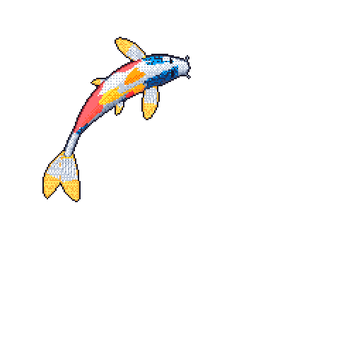
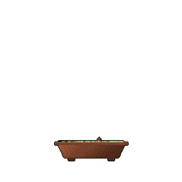

## Hi there 👋

I'm Kevin. I currently work as a Grad @ [EPEC Group](https://epecgroup.com.au/)
 

  
  
  <picture>
    <source media="(prefers-color-scheme: dark)" srcset="profile/stats-dark.svg" />
    <source media="(prefers-color-scheme: light)" srcset="profile/stats-light.svg" />
    
  </picture>
  <picture>
    <source media="(prefers-color-scheme: dark)" srcset="profile/top-langs-dark.svg" />
    <source media="(prefers-color-scheme: light)" srcset="profile/top-langs-light.svg" />
    
  </picture>

 

  <picture>
    <source
      media="(prefers-color-scheme: dark)"
      srcset="https://raw.githubusercontent.com/Hasakev/Hasakev/output/github-contribution-grid-snake-dark.svg"
    />
    <source
      media="(prefers-color-scheme: light)"
      srcset="https://raw.githubusercontent.com/Hasakev/Hasakev/output/github-contribution-grid-snake.svg"
    />
    
  </picture>

